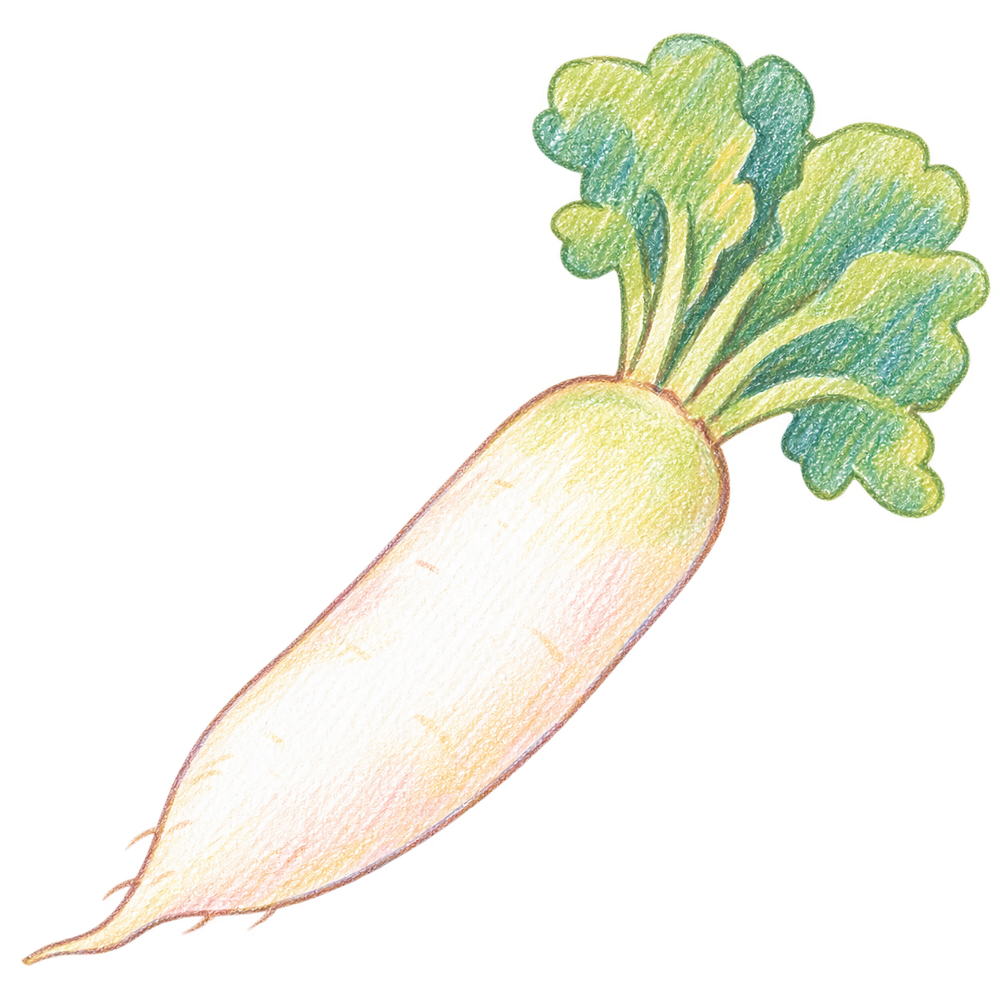

# イラスト

## 絵柄

絵本のような、やわらかい色鉛筆タッチにする。

- 淡い色と、白い紙目を残す塗り。
- 丸く簡略化した形と、少し揺れのある輪郭。
- 細かな葉脈・うろこ・皮の質感を描き込みすぎない。
- 強い陰影や光沢を抑える。
- 食材の形や色、注目箇所を見分けられることを優先する。

## 一覧のイラスト

食材を見つけるための図鑑風イラストにする。

- 食材の全体像と、見分けるための特徴を描く。
- 食材本来の色や形を残す。
- 背景や飾りを省き、小さな表示でも見分けやすくする。
- 背景を透過し、カードの色になじませる。

## 選び方のイラスト

店頭で確認する部分や状態を説明するイラストにする。

- 一覧の絵をそのまま大きく載せる構成にせず、説明に合った構図を使う。
- 注目する部分を、拡大・丸・矢印などで示す。
- 一覧の構図にそろえることより、選び方が伝わることを優先する。
- 説明文は画像から分け、UI のテキストとして添える。

