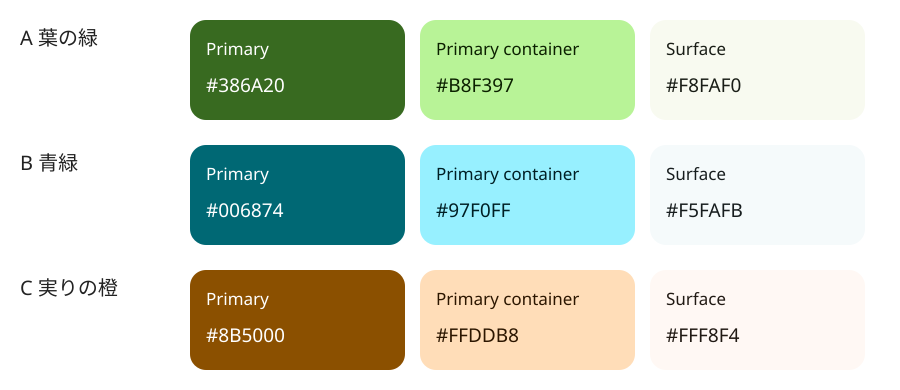

# 配色案

Material 3 の色ロールに沿った比較案。ユーザーの意向により、C「実りの橙」に近い暖色をベースに進める。方向性の合意であり、色コードの確定ではない。以下はライトテーマの主要ロールの候補値であり、生成済みの完全な ColorScheme ではない。全ロールとダークテーマを整え、実際の画面で確認する。

## 3つの候補

| 役割                                       | A：葉の緑 | B：青緑   | C：実りの橙（採用方向） |
| ------------------------------------------ | --------- | --------- | ----------------------- |
| primary：主要な操作・強調                  | `#386A20` | `#006874` | `#8B5000`               |
| onPrimary：primary 上の文字・アイコン      | `#FFFFFF` | `#FFFFFF` | `#FFFFFF`               |
| primaryContainer：関連要素の淡い背景       | `#B8F397` | `#97F0FF` | `#FFDDB8`               |
| onPrimaryContainer：その上の文字・アイコン | `#0B2000` | `#001F24` | `#2C1600`               |
| surface：画面の基本背景                    | `#F8FAF0` | `#F5FAFB` | `#FFF8F4`               |
| onSurface：基本の文字・アイコン            | `#191D16` | `#171D1E` | `#211A14`               |

- A：自然や葉を連想する落ち着いた緑。野菜を優先する企画に合う。絵を主役にしやすい。
- B：すっきりとした青緑。魚も含む図鑑として、涼しげで落ち着いた印象。
- C：温かみのある橙。食べ物への親しみを出しやすい。食材の橙・赤と競合しないよう、アクセントの面積を抑える。

上記の on 色と背景色の3組は、sRGB の相対輝度による計算で、全候補ともコントラスト比 4.5:1 以上を確認済み。画面全体のアクセシビリティ検証を完了したという意味ではない。

## 暖色で進める際の方針

- 広い面には温かみのある白や淡いニュートラル色を使う。
- 落ち着いた橙を primary の軸として、操作や強調に使う。
- 本文は濃いニュートラル色にして、読みやすさを保つ。
- 橙の大きな色面を増やしすぎず、食材の赤・橙・黄も見分けやすい画面にする。
- secondary・tertiary を含む全ロールとダークテーマの具体値は、次の検討で整える。

## 共通の配色ルール

### 背景に温かみを足すラフの試作

背景全体に色を感じられる案を試すため、HTML ラフでは以下の候補値を使う。採用確定ではなく、全 ColorScheme の生成・調整前の比較用。

| 用途                   | 色ロール            | 試作値                      |
| ---------------------- | ------------------- | --------------------------- |
| 画面全体               | surface             | `#FFF2DA`：薄いクリーム     |
| 食材カード・説明図の面 | surfaceContainerLow | `#FFFAF0`：明るいアイボリー |
| ボトムシート           | surfaceContainer    | `#F5E6CE`：少し深いクリーム |
| 基本文字               | onSurface           | `#211A14`                   |
| 補足の文字             | onSurfaceVariant    | `#51453A`                   |

### 色の使い方

- 色は名前や食材カテゴリではなく、Material 3 の役割で管理する。
- 背景と文字を対応させる。primary には onPrimary、primaryContainer には onPrimaryContainer、surface には onSurface を使う。
- 食材カードは、採用スキームの surfaceContainer 系と対応する onSurface を基本にする。カード全体を鮮やかな色で埋めず、絵を引き立てる。
- 「いまが 旬」「そろそろ 旬」は文字と配置で区別する。旬の状態に error などの別の意味を持つ色を流用しない。
- イラスト内の食材の色は識別のために保つ。UI テーマに合わせて食材を着色しない。
- secondary・tertiary は補助的な役割として全体のスキームに含めるが、使う場所を無理に増やさない。
- ライト・ダークはそれぞれの色ロールを定義する。ライトの色をそのままダークに流用しない。
- Dynamic Color の採否は未決定。固定のブランド配色を使うことも Material 3 と両立する。

## 参考

- [Material Design 3：Color roles](https://m3.material.io/styles/color/roles)
- [Android Developers：Material Design 3](https://developer.android.com/develop/ui/compose/designsystems/material3)
- [Material Components Android：Color theming](https://github.com/material-components/material-components-android/blob/master/docs/theming/Color.md)
